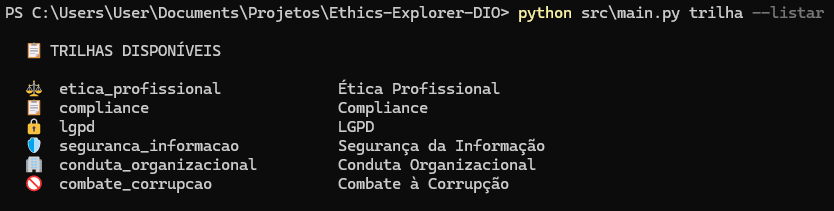
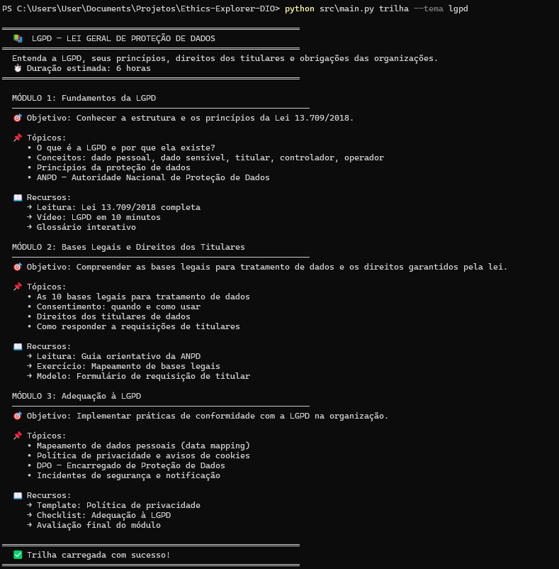
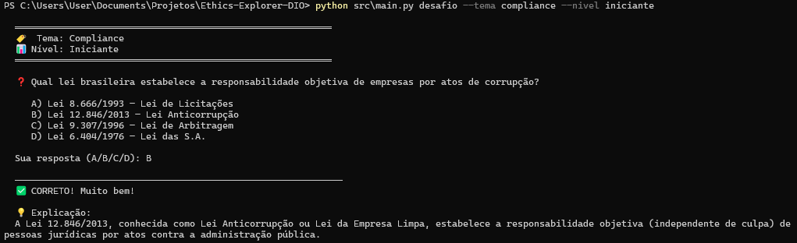
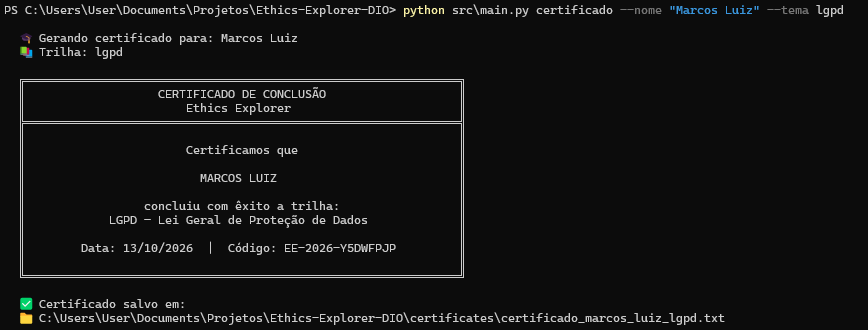

# Ethics Explorer

<p align="center">
  
  
  
  
</p>

> **Plataforma educacional de ética, compliance e conduta organizacional.**  
> Aprenda, pratique e certifique seus conhecimentos em temas essenciais para o ambiente corporativo moderno.

---

## 📖 Sobre o Projeto

O **Ethics Explorer** é uma plataforma educacional em linha de comando (CLI) focada em temas críticos para profissionais e organizações:

- ⚖️ **Ética Profissional**
- 📋 **Compliance**
- 🔒 **LGPD** (Lei Geral de Proteção de Dados)
- 🛡️ **Segurança da Informação**
- 🏢 **Conduta Organizacional**
- 🚫 **Combate à Corrupção**

A plataforma oferece três recursos principais: trilhas de estudo estruturadas, desafios de conhecimento por tema e nível, e emissão de certificados fictícios de conclusão.

---

## 🚀 Funcionalidades

| Comando | Descrição |
|---|---|
| `trilha` | Exibe um plano de estudos completo sobre um tema escolhido |
| `desafio` | Gera questões de múltipla escolha por tema e nível de dificuldade |
| `certificado` | Emite um certificado fictício de conclusão de trilha |

---

## 📸 Demonstração

### Temas Disponíveis



> Visão geral de todos os temas abordados pela plataforma: Ética Profissional, Compliance, LGPD, Segurança da Informação, Conduta Organizacional e Combate à Corrupção. Cada tema possui trilha de estudos, desafios e certificado próprios.

---

### Trilha de Estudos — LGPD



> Exibe o plano de estudos completo da trilha **LGPD — Lei Geral de Proteção de Dados**, organizado em módulos com objetivos, tópicos e duração estimada. O usuário acompanha, passo a passo, os conceitos essenciais da lei — desde dados pessoais e bases legais até os direitos dos titulares e as obrigações das organizações.

---

### Desafio de Compliance



> Sessão interativa de perguntas de múltipla escolha sobre **Compliance**, nível iniciante. Após cada resposta, a plataforma exibe feedback imediato com o resultado (✅ correto / ❌ incorreto) e uma explicação detalhada, reforçando o aprendizado de forma prática diretamente no terminal.

---

### Certificado de Conclusão — Ética



> Ao concluir uma trilha, a plataforma emite um **certificado fictício de conclusão** personalizado com o nome do participante, o tema cursado, a data e um código único de verificação. O arquivo é salvo automaticamente na pasta `certificates/` para consulta futura.

---

## 📦 Instalação

### Pré-requisitos

- Python 3.10 ou superior
- pip

### Passo a passo

```bash
# 1. Clone o repositório
git clone https://github.com/Cempressa/Ethics-Explorer-DIO.git
cd Ethics-Explorer-DIO

# 2. Crie e ative um ambiente virtual
python -m venv venv

# Windows
venv\Scripts\activate

# Linux / macOS
source venv/bin/activate

# 3. Instale as dependências
pip install -r requirements.txt
```

---

## 🎯 Como Usar

### Trilha de Estudos

Exibe um plano de estudos completo sobre um tema:

```bash
python src/main.py trilha --tema lgpd
python src/main.py trilha --tema compliance
python src/main.py trilha --tema etica_profissional
```

**Temas disponíveis:**
- `etica_profissional`
- `compliance`
- `lgpd`
- `seguranca_informacao`
- `conduta_organizacional`
- `combate_corrupcao`

---

### Desafio

Gera um desafio de conhecimento com questões de múltipla escolha:

```bash
# Desafio iniciante sobre LGPD
python src/main.py desafio --tema lgpd --nivel iniciante

# Desafio avançado sobre compliance
python src/main.py desafio --tema compliance --nivel avancado

# Desafio aleatório (tema e nível sorteados)
python src/main.py desafio --aleatorio
```

**Níveis disponíveis:** `iniciante` · `intermediario` · `avancado`

---

### Certificado

Gera um certificado fictício de conclusão após estudar uma trilha:

```bash
python src/main.py certificado --nome "Maria Silva" --tema lgpd
```

O certificado será salvo em `certificates/` no formato `.txt`.

**Exemplo de saída:**

```
╔══════════════════════════════════════════════════════════╗
║              CERTIFICADO DE CONCLUSÃO                    ║
║                  Ethics Explorer                         ║
╠══════════════════════════════════════════════════════════╣
║  Certificamos que                                        ║
║                                                          ║
║  Maria Silva                                             ║
║                                                          ║
║  concluiu com êxito a trilha:                            ║
║  LGPD — Lei Geral de Proteção de Dados                   ║
║                                                          ║
║  Data: 13/10/2026  |  Código: EE-2026-A1B2C3D4          ║
╚══════════════════════════════════════════════════════════╝
```

---

## 🧪 Testes

O projeto usa **pytest** para testes automatizados.

```bash
# Executar todos os testes
pytest tests/ -v

# Executar testes de um módulo específico
pytest tests/test_trilha.py -v
pytest tests/test_desafio.py -v
pytest tests/test_certificado.py -v

# Executar com relatório de cobertura
pytest tests/ --cov=src --cov=commands --cov-report=term-missing
```

---

## 🏗️ Arquitetura

```
Ethics-Explorer/
│
├── data/              # Dados estáticos em JSON (trilhas, desafios, categorias)
├── commands/          # Comandos CLI (trilha, desafio, certificado)
├── certificates/      # Certificados gerados (saída)
├── mcp/               # Integração com Model Context Protocol
├── docs/              # Documentação técnica
├── tests/             # Testes automatizados (pytest)
└── src/               # Núcleo: modelos, serviços, utilitários e ponto de entrada
```

Consulte [`docs/arquitetura.md`](docs/arquitetura.md) para a documentação técnica completa.

---

## 🔌 Integração MCP

O Ethics Explorer está preparado para funcionar como um servidor MCP, expondo suas funcionalidades como ferramentas (tools) para agentes de IA:

| Tool MCP | Descrição |
|---|---|
| `get_trilha` | Retorna a trilha de estudos de um tema |
| `get_desafio` | Gera um desafio por tema e nível |
| `generate_certificado` | Gera um certificado fictício |

Consulte [`docs/uso.md`](docs/uso.md) para instruções de uso do servidor MCP.

---

## 🗄️ Integração Appwrite (futura)

O projeto está estruturado para migrar os dados de JSON para o **Appwrite** como backend:

- `data/trilhas.json` → Collection `trilhas` no Appwrite
- `data/desafios.json` → Collection `desafios` no Appwrite
- Certificados gerados → Storage do Appwrite
- Progresso do usuário → Collection `progresso` no Appwrite

A migração exigirá alterações apenas em `src/services.py`, sem impacto nos comandos ou na interface.

---

## 📚 Documentação

| Documento | Descrição |
|---|---|
| [`docs/arquitetura.md`](docs/arquitetura.md) | Visão geral da arquitetura do projeto |
| [`docs/modelo_dados.md`](docs/modelo_dados.md) | Estrutura dos arquivos JSON |
| [`docs/uso.md`](docs/uso.md) | Guia completo de uso e exemplos |

---

## 🤝 Contribuindo

1. Faça um fork do projeto
2. Crie uma branch para sua feature: `git checkout -b feature/nova-funcionalidade`
3. Commit suas mudanças: `git commit -m 'feat: adiciona nova funcionalidade'`
4. Push para a branch: `git push origin feature/nova-funcionalidade`
5. Abra um Pull Request

---

## 📄 Licença

Este projeto está licenciado sob a **Licença MIT**. Veja o arquivo [LICENSE](LICENSE) para mais detalhes.

---

<p align="center">
  Feito com ❤️ para promover ética e integridade no mundo corporativo.
</p>
